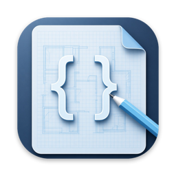
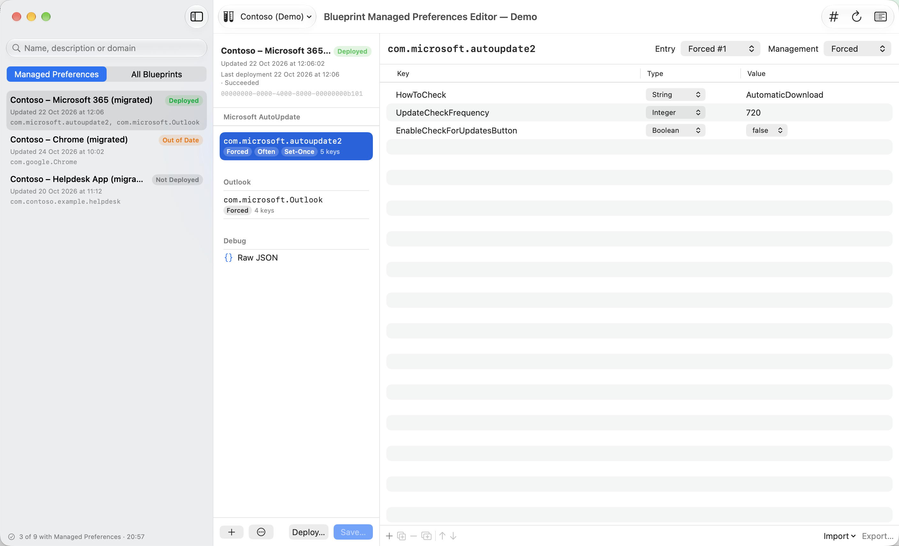

> [!IMPORTANT]
> **Archived.** Blueprint Managed Preferences Editor is no longer maintained. Use Blueshift by Jamf Concepts instead: its Edit Values edits the Managed Preferences values Jamf Pro’s Blueprint editor can’t open, on any Blueprint, as Blueprint Managed Preferences Editor does. Blueshift never deploys: deploying is done in Jamf Pro.
>
> [Open Blueshift](https://github.com/Jamf-Concepts/blueshift)

  

# Blueprint Managed Preferences Editor

*Edit the Managed Preferences that Jamf Pro’s Blueprint UI can’t.*

## What it does

When Jamf Pro turns a classic configuration profile with an **Application & Custom Settings** payload into a Blueprint, that payload becomes a read-only legacy **Managed Preferences** payload (`com.apple.ManagedClient.preferences`). The Jamf Pro UI shows it but can’t edit it, and points you to the Jamf Platform API instead.

Blueprint Managed Preferences Editor is a macOS app that uses that API for you. It finds every Blueprint with a Managed Preferences payload, lets you edit the payload in an outline editor, and saves your changes back. Deploying stays a separate, explicit step.

## Installation

Download the latest notarized build from [Releases](https://github.com/JordyThery/Blueprint-Managed-Preferences-Editor/releases/latest), unzip it, and move the app to `/Applications`. The app checks for new releases once a day and offers the download; use **Check for Updates…** in the app menu to check right away.

## Features

- **Discovery**: lists every Blueprint that contains Managed Preferences, with its deployment state, last update and preference domains. Search by name, description or domain, switch to **All Blueprints** to see the rest, or use **Fetch by ID** to load one Blueprint you know.
- **Domains**: add, rename and remove preference domains, and switch each one between **Forced**, **Set-Once** and **Often**.
- **Outline editor**: in the style of Xcode’s property list editor, with String, Integer, Real, Boolean, Date, Data, Array and Dictionary types. Add, delete, duplicate, reorder and nest items. Values are validated as you edit.
- **Import and export**: import domains, or replace one domain’s settings, from a `.plist`, a `.mobileconfig` (signed or unsigned) or pasted text, and export any domain as a `.plist`. A file without settings for the domain asks before its other settings are used, and domains with an unexpected shape are left alone.
- **Review before saving**: a diff of old and new values for each domain and key, then **Save** or **Save & Deploy**.
- **Undo and redo** for every edit. Unsaved changes are marked on the window and in the sidebar. **Discard Changes…**, **Reload from Server** and Quit ask before unsaved edits are lost; Quit also asks while a save, deploy or restore is running.
- **Multiple connections** to switch between tenants. Changing connections, changing the active connection’s region, Environment ID or client ID, or deleting it, clears the Blueprints of the previous one.
- **Demo Mode**: try the app with sample Contoso Blueprints and no Jamf tenant. Turn it on in the connection picker or the Connection menu, or with **Try Demo Mode**. The picker reads “Contoso (Demo)” and window titles end in “— Demo”. Nothing is sent to a tenant and everything resets when the app quits.
- **Settings**: **Connections** and **Updates**. The app follows your Mac’s Light or Dark appearance.
- **Waits shown, with Stop**: when Jamf asks the app to wait before trying a request again (at most 60 seconds), the wait is shown while Blueprints are read, saved, deployed or restored, and during Test Connection and Load Environments in Settings, with **Stop** to end it. The message then says whether anything reached Jamf.
- **Blueprint menu**: **Save…** (⌘S), **Save & Deploy…** (⌥⌘S), **Deploy…** (⇧⌘D), **Restore from Backup…**, **New Domain…** (⇧⌘N), **Rename Domain…**, **Remove Domain**, **Import Domains from File…** (⇧⌘I) and **Export Domain…** (⇧⌘E). Results such as “Saved” appear in the window.
- **Activity log and raw JSON**: every sign-in and API call is logged (Window › Activity Log, ⇧⌘L) with secrets redacted; request contents are never logged. The raw JSON view shows the Blueprint as received (**Pretty** or **Exact Response**) and, with unsaved edits, the **Pending PATCH Body** Save will send, each with **Copy** and **Save…**. Only GET requests, token requests, and Blueprint update and deploy requests are ever sent.

## Saving safely

The Jamf Platform API applies Blueprint updates as a JSON merge-patch, and a merge-patch replaces arrays wholesale. A careless save can therefore delete parts of a Blueprint. The app guards against this:

- **Nothing outside your edit changes.** Every save sends the complete `steps` array, with every step and component exactly as it was received except the Managed Preferences you edited. Unedited content is sent back byte for byte.
- **Concurrent changes are caught.** Just before saving, restoring or deploying, the Blueprint is fetched again. If its steps or its last-updated time changed on the server since you loaded it, nothing is changed and you’re told what changed. A deploy also stops when the scope changed, so it never goes to a scope you didn’t confirm. While a save, deploy or restore runs, the connection and Demo Mode can’t be switched.
- **Every save and restore is backed up first.** The full Blueprint is written to `~/Library/Application Support/Blueprint Managed Preferences Editor/Backups/<Blueprint ID>/` (**Show Backups in Finder**), and **Restore from Backup** puts those steps back.
- **Division-locked Blueprints are left alone.** `divisionId` is never sent. Blueprints that Jamf reports as assigned to a division are marked read-only, as are Blueprints whose changes Jamf refuses for that reason.
- **Deployment needs confirmation.** After a save the Blueprint shows *Out of Date* until you deploy it, and deploying asks for confirmation, showing the Blueprint name and its scope. **Deploy…** is unavailable while edits are unsaved (**Save & Deploy…** in the review does both) and on division-locked Blueprints.

## Compared with Blueshift

[Blueshift](https://github.com/Jamf-Concepts/blueshift), a Jamf Concepts project for moving classic configuration profiles to Blueprints, can also edit the Managed Preferences values that the Jamf Pro Blueprint editor can’t open, on any Blueprint, as a form or a plist. Blueprint Managed Preferences Editor is built only for that: a typed outline editor, Forced, Set-Once and Often per domain, undo and redo, a backup before every save, and a check for changes made in Jamf in the meantime.

## Requirements

- macOS 15 or later
- A Jamf Platform API client (US, EU or APAC region) with the `blueprints:read`, `blueprints:update` and `blueprints:deploy` permissions. **Test Connection** checks only `blueprints:read`; the write permissions can’t be checked without writing.
- Your **Environment ID**, a UUID: use **Load Environments** in Settings › Connections (organization-scope API clients), or copy it from the integration’s details in Jamf Account. An Environment ID that isn’t a UUID is flagged under its field, and nothing is sent until it’s corrected.

## Getting started

1. Open **Settings** (⌘,) › **Connections**, add a connection, enter the region, client ID and client secret, choose the Environment ID with **Load Environments** (or paste it), and click **Test Connection**. To look around first, click **Try Demo Mode** in the main window, or choose Demo Mode in the connection picker or the Connection menu.
2. Click **Refresh** (⌘R) to discover Blueprints with Managed Preferences.
3. Select a Blueprint, then a domain, and edit its keys.
4. Click **Save…** (⌘S), review the changes, and save. Deploy when you’re ready.

## Security

- **Credentials** stay on your Mac. Client secrets are stored in the login Keychain; the other connection settings are stored in user defaults. When the Keychain is locked or refuses access, the app says so instead of reporting a missing connection.
- **Network**: the app talks only to `{region}.api.jamfcloud.com` (sign-in, Blueprints and, with **Load Environments**, the organization’s environment list), plus one daily request to GitHub asking whether a newer release exists. That request sends nothing else and can be turned off in Settings.
- **Activity log**: kept in memory only, with tokens and secrets redacted. Request contents are never recorded, and responses only when the server reports an error. **Export for Bug Report…** replaces device identifiers (serial numbers, device names), usernames, emails and IP addresses with placeholders; **Export Unmasked…** keeps them.
- **Backups** contain the full Blueprint JSON as it was on the server, including any values in its Managed Preferences, such as license keys or tokens, but no Jamf credentials. They are stored unencrypted in your user Library, readable by your user account only, one per save and restore, and never deleted by the app: remove old ones yourself with **Show Backups in Finder**. In Demo Mode, backups go to a temporary folder instead.
- **No sandbox**: the app is not sandboxed, so backups are written to the exact path above. It runs with the Hardened Runtime.

## Known limitations

- **Date and Data values**: JSON has no Date or Data type, so these are sent as ISO 8601 and Base64 strings. Values you mark as Date or Data load back as String.
- **Scope**: shown as device group IDs. The app doesn’t read device groups, so it needs no `device-groups` permission.
- **Unrecognized payloads**: payloads or domains with an unexpected shape are shown read-only and saved back unchanged.

## Building

Open `Blueprint Managed Preferences Editor.xcodeproj` in Xcode 27 or later and build the `Blueprint Managed Preferences Editor` scheme (⌘R). Run the tests with ⌘U.

The app’s only package dependency is [JTKit](https://github.com/JordyThery/JTKit), the shared package of these apps. Resolving it also downloads Microsoft’s MSAL, which JTKit uses for Intune sign-in and which this app doesn’t link or ship.

## Support

If Blueprint Managed Preferences Editor saves you time, you can [buy me a coffee](https://buymeacoffee.com/jordythery). ☕️

## Disclaimer

This tool is provided as-is, without warranty of any kind. Use it at your own risk. This is a personal project. It is not affiliated with or endorsed by my employer or Jamf. Issues and pull requests are appreciated. Support is best-effort.

## License

[MIT](LICENSE)
