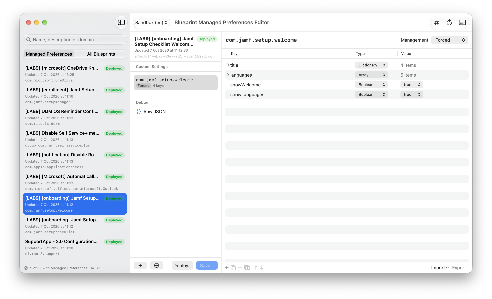

  

# Blueprint Managed Preferences Editor

*Edit the Managed Preferences that Jamf Pro's blueprint UI can't.*

## What it does

When Jamf Pro turns a classic configuration profile with an **Application & Custom Settings** payload into a blueprint, that payload becomes a read-only legacy **Managed Preferences** component (`com.apple.ManagedClient.preferences`). The Jamf Pro UI shows it but can't edit it, and points you to the Blueprints API instead.

Blueprint Managed Preferences Editor is a macOS app that uses that API for you. It finds every blueprint with a Managed Preferences payload, lets you edit the payload in a visual property-list editor, and saves your changes back. Deploying stays a separate, explicit step.

## Installation

Download the latest notarized build from [Releases](https://github.com/JordyThery/Blueprint-Managed-Preferences-Editor/releases/latest), unzip it, and move the app to `/Applications`. The app checks for new releases once a day and offers the download; use **Check for Updates…** in the app menu to check right away.

## Features

- **Discovery**: lists every blueprint that contains Managed Preferences, with its deployment state, last update and preference domains. You can search by name, description or domain.
- **Domains**: add, rename and remove preference domains, and switch each one between **Forced**, **Set-Once** and **Often**.
- **Key/value editor**: an outline editor in the style of Xcode's plist editor, with String, Integer, Real, Boolean, Date, Data, Array and Dictionary types. Add, delete, duplicate, reorder and nest items. Values are validated as you edit.
- **Import and export**: replace a domain's settings from a `.plist`, a `.mobileconfig` (signed or unsigned) or pasted text, and export any domain as a `.plist`.
- **Review before saving**: a diff of old and new values for each domain and key, then **Save** or **Save & Deploy**.
- **Undo and redo** for every edit. Unsaved changes are marked on the window and in the sidebar.
- **Multiple connections** to switch between tenants.
- **Request log and raw JSON**: every API call is logged with secrets redacted, and the raw JSON view shows the exact body Save will send.

## Saving safely

The Blueprints API applies updates as a JSON merge-patch, and a merge-patch replaces arrays wholesale. A careless save can therefore delete parts of a blueprint. The app guards against this:

- **Nothing outside your edit changes.** Every save sends the complete `steps` array, with every step and component exactly as it was received except the Managed Preferences you edited. Unedited content is sent back byte for byte.
- **Concurrent changes are caught.** Just before saving, the blueprint is fetched again. If it changed on the server since you loaded it, nothing is saved and you're warned.
- **Every save is backed up first.** The full blueprint is written to `~/Library/Application Support/Blueprint Managed Preferences Editor/Backups/<blueprint ID>/`, and **Restore from Backup** puts those steps back.
- **Division-locked blueprints are left alone.** `divisionId` is never sent. Blueprints assigned to a division are marked read-only.
- **Deployment needs confirmation.** After a save the blueprint shows *Out of Date* until you deploy it, and deploying asks for confirmation, showing the blueprint name and its scope.

## Requirements

- macOS 15 or later
- A Jamf Platform API client (US, EU or APAC region) with the `blueprints:read`, `blueprints:update` and `blueprints:deploy` scopes
- Your Platform **Environment ID**. The API has no endpoint to look it up, so you enter it yourself.

## Getting started

1. Open **Settings** (⌘,), add a connection, enter the region, Environment ID, Client ID and Client Secret, and click **Test Connection**.
2. Click **Refresh** (⌘R) to discover blueprints with Managed Preferences.
3. Select a blueprint, then a domain, and edit its keys.
4. Click **Save…** (⌘S), review the changes, and save. Deploy when you're ready.

## Security

- **Credentials** stay on your Mac. Client secrets are stored in the keychain; the other connection settings are stored in user defaults.
- **Network**: the app talks only to `{region}.api.jamfcloud.com`, plus one daily request to GitHub asking whether a newer release exists. That request sends nothing else and can be turned off in Settings.
- **Request log**: kept in memory only, with tokens and secrets redacted.
- **Backups** contain the blueprint's JSON and no credentials. They are stored unencrypted in your user Library.
- **No sandbox**: the app is not sandboxed, so backups are written to the exact path above. It runs with the Hardened Runtime.

## Known limitations

- **Date and Data values**: JSON has no Date or Data type, so these are sent as ISO 8601 and Base64 strings. Values you mark as Date or Data load back as String.
- **Scope**: shown as device group IDs, because the Blueprints API doesn't return group names.
- **Unrecognized payloads**: payloads or domains with an unexpected shape are shown read-only and saved back unchanged.

## Building

Open `Blueprint Managed Preferences Editor.xcodeproj` in Xcode 27 or later and build the `Blueprint Managed Preferences Editor` scheme (⌘R). Run the tests with ⌘U. Depends on [JTKit](https://github.com/JordyThery/JTKit), Jordy's own shared package; no third-party dependencies.

## Support

If Blueprint Managed Preferences Editor saves you time, you can [buy me a coffee](https://buymeacoffee.com/jordythery). ☕️

## License

[MIT](LICENSE)
